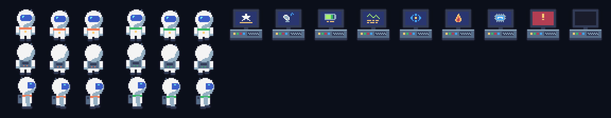

# Lactomeda art style guide

Owner: Matthew (Dev 3). Jira: SCRUM-27. Every sprite, tile and UI panel follows these rules so the
game looks like one piece.

## 1. Grid and resolution

| Rule | Value |
| --- | --- |
| Tile size | **32 × 32 px** — everything snaps to this grid |
| Character size | 32 × 32 px per frame |
| Game resolution | 640 × 360 px (20 × 11 tiles), scaled up to the window |
| Scaling | Integer only (2×, 3×…), never blurry: Phaser `pixelArt: true`, CSS `image-rendering: pixelated` |
| Perspective | Top-down with a slight front view (we see the front of consoles and characters) |

## 2. Palette — Sweetie 16

All our own sprites use only these 16 colours. Status colours always mean the same thing.

| Letter in generator | Hex | Use |
| --- | --- | --- |
| K | `#1a1c2c` | Outlines, darkest shadows |
| D | `#333c57` | Dark metal, bezels, boots |
| M | `#566c86` | Metal, desks, backpack |
| G | `#94b0c2` | Light metal, suit shading |
| W | `#f4f4f4` | Suit, text on screens |
| B | `#29366f` | Screens (normal) |
| V | `#3b5dc9` | Helmet visor |
| C | `#41a6f6` | Info, comms, cyan player |
| c | `#73eff7` | Shine / highlights |
| N | `#38b764` | **OK / green status**, green player |
| n | `#a7f070` | Charts, energy |
| Y | `#ffcd75` | **Warning / amber status**, yellow player |
| r | `#ef7d57` | Fire, orange player |
| R | `#b13e53` | **Alarm / red status** |
| T | `#257179` | Spare (teal) |
| P | `#5d275d` | Spare (purple) |

Status rule: green = margin ≥ 20%, amber/yellow = 0–20%, red = below 0 or an active alarm.
Always pair a status colour with an icon or text (accessibility, NFR-05).

## 3. Characters

- One astronaut design; the **chest band and backpack lights** take the player colour:
  orange, green, cyan, yellow (player 1–4).
- Spritesheet per colour: `public/assets/sprites/astronaut_<colour>.png`, 96 × 96 px.
  - Rows: 0 = facing down, 1 = facing up, 2 = facing right (flip horizontally for left).
  - Columns: 0 = idle, 1 = left step, 2 = right step.
- Phaser: `this.load.spritesheet('astro-orange', 'assets/sprites/astronaut_orange.png', { frameWidth: 32, frameHeight: 32 })`.
  Walk animation = frames 1, 0, 2, 0 at 8 fps.

## 4. Station consoles

One 32 × 32 tile per station, screen shows the station's icon:

| File | Station (ERS §2) | States |
| --- | --- | --- |
| `console_bridge.png` | Bridge | normal |
| `console_comms.png` | Comms Center | normal |
| `console_power.png` | Power Unit | normal |
| `console_science.png` | Science Lab | normal |
| `console_navigation.png` | Navigation & Attitude | normal |
| `console_engine.png` | Engine Bay | normal |
| `console_computer.png` | Computer Core | normal |
| `console_alarm.png` | any station during an alarm | swap in, blink at 2 Hz |
| `console_off.png` | any station when offline/damaged | swap in |

## 5. Tileset (floors, walls, doors, props)

- **Base tileset:** "Sci-fi Interior tiles" by Buch, OpenGameArt, **CC0**, 32 × 32
  (https://opengameart.org/content/sci-fi-interior-tiles).
- Download `scifitiles-sheet.png` and put it in `public/assets/tilesets/scifitiles-sheet.png`.
- Check the grid once: open it in LibreSprite (View → Grid, 32 × 32) and confirm tiles line up. If they are 16 × 16, tell Claude — the generator can switch size.
- If its colours clash with our sprites, it is fine to recolour it toward the palette above (CC0 allows edits).

## 6. Ship interior (generated, SCRUM-119 / FR-13.1)

The ship is **not** drawn in Tiled: `src/game/shipLayout.ts` builds it from the player's design
(one station per installed subsystem, rooms from the bus class). Every tile index lives in
`src/game/tiles.ts` (index = row × 14 + col, see `docs/tileset-grid.png`):

| Name | Index | Use |
| --- | --- | --- |
| `FLOOR` | 20 | room floor |
| `DOORWAY` | 4 | doorways and short corridors (blue hazard stripes) |
| `VOID` | 17 | wall tops and space outside the ship (collides) |
| `WALL_TOP_A` / `WALL_TOP_B` | 28 / 29 | upper wall-face row (collides) |
| `WALL_FACE` / `_PIPES` / `_SCREENS` | 42 / 43 / 44 | lower wall-face row, 43/44 as decor (collides) |
| `HATCH_BLUE` / `DOOR_BLUE` | 2 / 3 | reserved for later decor |

Not used: 30 (its top half is transparent) and 16 (purple strip on its top edge looks noisy when repeated).

- Each room = floor rectangle with a 2-tile wall face on top; side and bottom walls are `VOID`.
- CubeSats get cramped rooms (7 × 6 floor), bigger buses 9 × 7; rooms widen if their consoles need it.
- Consoles are 2 × 2 tiles (32 px sprite at 2×), against the top wall, 1 tile apart, never in a doorway.
- Room names sit on the wall above each room's top-left corner. The player spawns in the bridge room.
- Preview any bus with `?ship=<busClassId>` (e.g. `?ship=large`, `?ship=cubesat-3u`); combine with `?demo=1`.

## 7. Fonts and UI

- Font: **Press Start 2P** (SIL Open Font License) for titles and HUD; body text may use a
  readable pixel font at 16 px.
- UI panels: dark metal (`D`) background, 2 px `G` border, `K` outer outline — same look as the consoles.

## 8. Making or changing sprites (no drawing needed)

1. Open `tools/sprites/make-sprites.mjs`.
2. Change a colour in `PAL`, a shape in `astronaut()` / `consoleTile()`, or an icon in `ICONS`
   (each letter = one pixel, `.` = background).
3. Run `npm run sprites` — PNGs in `public/assets/sprites/` and `docs/art-preview.png` are regenerated.
4. Commit both the script change and the new PNGs.

## 9. Licences

Only CC0 assets or assets we made ourselves. Every external file gets a line in `REFERENCES.md`
(Space Apps requirement). The palette is Sweetie 16 by GrafxKid (a colour list, credited as courtesy).
